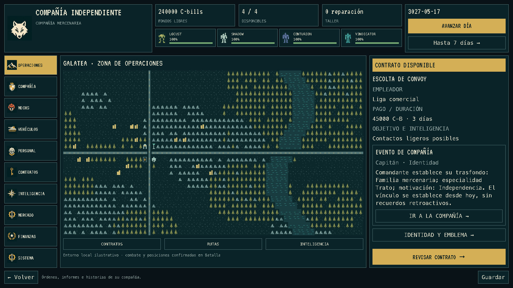

# BattleTech Mercenary Command

Un juego de gestión y rol donde dirigís una compañía mercenaria en el universo BattleTech. Administrá personal, BattleMechs, vehículos, contratos y C-bills mientras las decisiones, los combates y las relaciones construyen la historia de tu compañía.

Sos el comandante: preparás la fuerza y das órdenes, pero no controlás cada disparo. Las operaciones se resuelven con unidades autónomas, informes e información incompleta. Estética de terminal low-res, sprites y mapas procedurales. Funciona sin conexión y no requiere MekHQ.



## Descargar y jugar

Descargá la última versión desde [Releases](https://github.com/itomaselli/Battletech-Mercenary-Command/releases/latest).

- **Windows x64:** extraé todo el ZIP y abrí `MercenaryCommand.exe`. Conservá el archivo `.pck` junto al ejecutable.
- **macOS:** extraé el ZIP y abrí `Mercenary Command`. Es una app independiente, sin notarización de Apple.
- **Desde el código:** abrí `project.godot` con Godot 4.4.1 y pulsá **F5** para jugar.

## Tu primera campaña

1. **Creá una carrera.** En **Sistema → Partidas**, elegí Nueva carrera. Seleccioná 3027 o 3060, los nombres de la compañía y del capitán, un emblema y tu trasfondo. La fuerza inicial sortea cuatro unidades del catálogo de la época, incluidos vehículos; también se genera el personal. Podés volver a sortear antes de confirmar.
2. **Conocé a tu gente.** En **Personal**, revisá habilidades, condición, salarios e historias. En **Mechs** y **Vehículos**, abrí los expedientes para consultar disponibilidad y mantenimiento.
3. **Elegí un contrato.** En **Contratos**, compará pago, duración y riesgo. Revisá las condiciones antes de aceptar; reservá fondos para salarios, reparaciones y suministros.
4. **Prepará la operación.** Seguí los pasos de **Operaciones → Plan**: seleccioná unidades disponibles, mando y directivas, revisá el resumen y autorizá el despliegue.
5. **Observá y mandá.** En **Batalla**, pausá o acelerá el encuentro, seleccioná un sector y transmití órdenes a los grupos. Los subordinados ejecutan las acciones; los informes y contactos representan lo que tu compañía conoce. También podés delegar.
6. **Gestioná las consecuencias.** Consultá el informe, repará la fuerza y reponé suministros. **Avanzar día** mueve el calendario administrativo; el reloj de la batalla se maneja por separado.
7. **Seguí la historia.** **Compañía** reúne comunicaciones, agenda y crónica. Desde su sección **Capitán** accedés al personaje y sus asuntos. Atendé decisiones pendientes y usá **Guardar** para conservar la campaña.

## Dónde encontrar cada cosa

| Menú | Para qué sirve |
| --- | --- |
| Operaciones | Situación, preparación, batalla e informes |
| Compañía | Comunicaciones, agenda, crónica, capitán y HQ |
| Mechs / Vehículos / Personal | Expedientes, asignaciones e historias |
| Contratos | Ofertas y condiciones de trabajo |
| Inteligencia | Atlas, contexto regional y contactos |
| Mercado | Unidades, repuestos y contratación |
| Finanzas | Fondos, compromisos y previsión |
| Sistema | Partidas, identidad, 50 emblemas y opciones visuales |

El mapa de **Territorio** es ambiental; el encuentro con posiciones y órdenes está en **Batalla**. Podés desactivar las líneas de escaneo y la viñeta en **Sistema → Opciones**.

## Conseguir un HQ

En **Compañía → HQ** podés conseguir una **Union usada**, bautizarla y asignar un enlace con su tripulación. La inspección se habilita desde el día 60, con reputación 4 y cuatro operaciones cumplidas registradas por el sistema de HQ. Elegí compra, patrocinio por servicio o recuperación mediante la red de salvamento. La pantalla explica los requisitos y costes antes de comprometer fondos.

La nave tiene **cuatro espacios para ocho tipos de instalaciones**, con dos niveles y ventajas moderadas. Construí desde Instalaciones; revisá obras, cursos y promesas en Proyectos. El mantenimiento cuesta 12000 C-bills por 30 días más las instalaciones. Reserva o deuda suspenden las ventajas. Las peticiones de la tripulación quedan en su historia y en los expedientes. El salto interestelar sigue contratado y el límite de despliegue sigue siendo cuatro unidades.

[Diseño y balance del HQ](docs/PLAN-HQ.md). Las partidas anteriores incorporan el proyecto sin inventar adquisiciones ni éxitos históricos; los cuatro éxitos requeridos se registran a partir de esta actualización.

## Desarrollo y créditos

Godot 4.4.1 / GDScript, con simulación separada de la interfaz. Para una comprobación básica:

```sh
godot --headless --path . --script tests/export_smoke.gd
```

Proyecto personal no oficial. Las mecánicas son una adaptación propia y simplificada, no una implementación completa del reglamento de BattleTech. Código bajo [GPL-3.0](LICENSE); referencias y atribuciones en [data/README.md](data/README.md), [arte de unidades](docs/UNIT-ART.md), [emblemas](assets/emblems/README.md) y [fuentes](assets/fonts/README.md). BattleTech pertenece a sus respectivos titulares.
